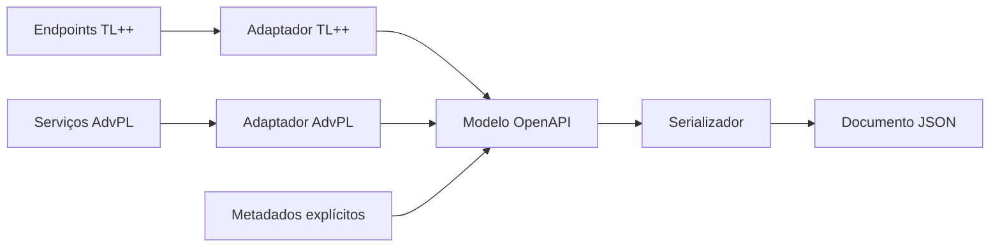

No [artigo anterior](/posts/yaml-invalido-encoding-normalizacao-protheus-openapi/), o laboratório chegou a um normalizador capaz de consolidar paths repetidos no YAML nativo, preservar o arquivo original e recusar conflitos. Essa ferramenta resolveu uma parte concreta do problema observado no REST-DOC.

Mesmo depois da normalização, porém, a operação AdvPL baseada em `WSRESTFUL` continuava ausente. Não havia metadados dessa operação no documento para reorganizar.

Esse limite levou à próxima decisão do Protheus OpenAPI: **construir uma representação própria da API, separando a descoberta dos endpoints da validação e da geração do documento**.

Neste artigo, apresento os motivos dessa escolha, as alternativas consideradas e o experimento usado para validá-la. O código e as evidências estão no [repositório Protheus OpenAPI](https://github.com/dirleiflsilva/protheus-openapi/tree/ca2260262f2be39401589139de29f6acf3a066de). O foco aqui é a decisão que originou o núcleo manual mínimo.

## O que o normalizador ensinou sobre o problema

Os experimentos anteriores separaram três questões que, inicialmente, poderiam parecer uma única dificuldade para gerar documentação:

| Questão | Evidência no laboratório | Responsabilidade envolvida |
|---|---|---|
| Descobrir a operação | O endpoint TL++ apareceu na exportação; o `WSRESTFUL` equivalente não apareceu | Obter metadados de cada origem |
| Representar operações sem conflito | O YAML agregado continha paths repetidos | Organizar paths e métodos com regras explícitas |
| Produzir um artefato consumível | A exportação usava Windows-1252 e exigiu leitura adequada | Interpretar e escrever o formato de saída |

Essas observações pertencem ao ambiente registrado, com Protheus `12.1.2510`, AppServer `24.3.1.5` e TLPPCore `01.06.01`. Elas não estabelecem o comportamento de todas as versões do produto.

O normalizador atua sobre um arquivo já produzido. Ele consegue reunir métodos diferentes sob o mesmo path, desde que os blocos sejam compatíveis. Não consegue acrescentar uma operação que o gerador não encontrou nem determinar o contrato de um payload construído dinamicamente.

Ampliá-lo para assumir essas tarefas exigiria introduzir novas fontes de informação e regras de composição. Nesse ponto, o projeto precisaria de uma representação comum para os dados coletados, independentemente de continuar usando ou não o YAML nativo.

## Qual é a independência que o projeto procura

Um modelo próprio não significa criar outro padrão de documentação. A saída continua tendo OpenAPI `3.0.3` como referência.

A independência está nas dependências do código: o núcleo deve representar uma API sem precisar conhecer `tlpp.doc.generate()`, annotations REST, declarações `WSRESTFUL`, arquivos ou detalhes da conexão HTTP.

Uma operação precisa preservar seu caminho, verbo, descrição e respostas. A forma usada para obter essas informações pertence à descoberta. A forma usada para escrevê-las como JSON pertence ao serializador.

Essa separação permite testar perguntas diferentes de maneira direta:

- O adaptador encontrou o verbo e o caminho corretos?
- O modelo aceita essa operação sem criar um conflito?
- O documento contém os campos mínimos exigidos pelas regras implementadas?
- O serializador preserva a estrutura ao produzir JSON?

Se todas essas decisões estivessem no mesmo fluxo de exportação, uma falha exigiria investigar descoberta, composição e escrita ao mesmo tempo.

## As alternativas consideradas

O [design do núcleo](https://github.com/dirleiflsilva/protheus-openapi/blob/ca2260262f2be39401589139de29f6acf3a066de/.specs/features/openapi-core-model/design.md) registra quatro caminhos avaliados:

| Abordagem | Decisão e motivo |
|---|---|
| Modelo próprio seguido de adaptadores | Escolhida para oferecer um contrato comum a TL++ e AdvPL |
| Pós-processar somente o YAML nativo | Mantida como utilitário experimental, com o alcance da exportação recebida |
| Começar pelo parser de `WSRESTFUL` | Adiada até existir um contrato estável para receber os metadados |
| Cada entidade serializar a si mesma | Rejeitada para manter regras do modelo e formato de saída separados |

Continuar pelo YAML aproveitaria um recurso já disponível. Essa opção fazia sentido para corrigir o artefato observado, mas manteria a biblioteca dependente do que o gerador nativo conseguisse descobrir e da estrutura que entregasse.

Começar pelo parser AdvPL atacaria a lacuna mais visível. Ainda assim, seria necessário decidir onde armazenar seus resultados, como identificar conflitos e como gerar a especificação. Construir primeiro um contrato pequeno permitiu experimentar essas regras antes de acrescentar a complexidade da análise de fontes.

O modelo próprio também tem um custo: suas regras, testes e serializadores precisam ser mantidos pelo projeto. Por isso, a primeira entrega foi limitada ao necessário para documentar o Hello World já conhecido.

## Três responsabilidades e um contrato comum

A direção arquitetural ficou assim:

Esse desenho expressa a direção do projeto. Ele não significa que todos os adaptadores e formatos tenham sido entregues junto com o núcleo inicial.

### Descoberta: obter informações da origem

O adaptador deve lidar com as particularidades da implementação: annotations em TL++, declarações em AdvPL ou metadados complementares.

Seu resultado precisa ser expresso pela API pública do modelo. A biblioteca pode, assim, receber informações de origens diferentes sem colocar regras de parsing dentro das classes que representam documento e operações.

Quando a origem não oferece informação suficiente, o projeto prevê complementação explícita. Um modelo comum organiza o que foi informado; ele não torna confiável uma inferência sem evidências.

### Modelo: preservar dados e aplicar regras

O modelo concentra as decisões sobre composição e consistência. Por exemplo, o mesmo path pode receber operações `get` e `post`, mas duas definições de `get` nesse mesmo path exigem um diagnóstico.

No núcleo mínimo, conflitos estruturais são rejeitados antes de alterar a coleção. Já as informações que podem ficar temporariamente incompletas durante a montagem são verificadas por `validate()`, que retorna uma lista de pendências. Esse método verifica as regras implementadas no núcleo, não toda a especificação OpenAPI.

Isso permite montar o documento em etapas e receber uma lista de pendências antes de tentar publicá-lo.

### Serialização: escrever o documento validado

O serializador percorre o modelo e produz a saída. Ele não precisa descobrir endpoints nem decidir qual operação conflitante deve prevalecer.

Na primeira entrega, o formato escolhido foi JSON. A geração de YAML ficou fora desse marco. O núcleo também permaneceu separado do endpoint REST usado para demonstrá-lo: a publicação HTTP é um cliente da biblioteca.

## Uma regra concreta: duas operações com o mesmo verbo

Imagine duas fontes de metadados tentando registrar `GET /api/v1/hello` no mesmo documento.

Se o código apenas atribuir um objeto à chave `get`, a segunda inclusão poderá substituir a primeira. O JSON final pode ser legível e ainda assim ter perdido uma definição sem qualquer aviso.

O contrato do núcleo exige que a inclusão duplicada falhe e preserve a operação original. O mesmo princípio vale para códigos de resposta repetidos dentro de uma operação.

Há uma diferença entre esse conflito e um documento ainda incompleto. Uma operação sem respostas pode existir durante sua montagem, mas precisa ser diagnosticada antes da serialização. O serializador deve recusar o documento e não devolver JSON parcial.

Essas regras são verificáveis mesmo sem executar um endpoint REST. São também regras que os futuros adaptadores podem compartilhar, em vez de implementar cada um sua própria política de substituição.

## O menor experimento capaz de validar a decisão

Para testar essa arquitetura, o primeiro núcleo foi montado manualmente em TL++. Ele reuniu seis classes no namespace `custom.openapi.core`:

| Classe | Papel no experimento |
|---|---|
| `OApiInfo` | Informações da API |
| `OApiResp` | Código e descrição de uma resposta |
| `OApiOper` | Verbo, metadados e respostas da operação |
| `OApiPath` | Caminho e suas operações |
| `OApiDoc` | Raiz OpenAPI e validação do conjunto |
| `OApiJson` | Serialização do modelo validado |

A montagem manual isolou a hipótese do experimento: representar o Hello World, aplicar as regras e produzir JSON sem depender da descoberta nativa.

O endpoint de demonstração `GET /api/v1/openapi/core` usou essas classes para documentar `GET /api/v1/hello`. A montagem ficou no exemplo; o núcleo não recebeu uma referência ao objeto REST.

O [diário técnico](https://github.com/dirleiflsilva/protheus-openapi/blob/ca2260262f2be39401589139de29f6acf3a066de/docs/experiments/openapi-core-model.md) registra compilação no ambiente `P12_2510`, testes TL++ com PROBAT e chamadas HTTP reais. A chamada autenticada retornou `200` com `application/json`; sem credenciais, o AppServer preservou o `401`.

Esses códigos confirmam comportamentos da publicação no ambiente testado. O `401` não demonstra modelagem de segurança na especificação: a autenticação continuou sob responsabilidade do AppServer.

## O que as evidências permitem afirmar

A [especificação do núcleo](https://github.com/dirleiflsilva/protheus-openapi/blob/ca2260262f2be39401589139de29f6acf3a066de/.specs/features/openapi-core-model/spec.md) relaciona 18 requisitos do projeto a evidências de construção, rejeição de conflitos, validação, serialização e execução HTTP.

O resultado sustenta o recorte proposto: um documento mínimo pode ser composto por objetos TL++, validado e serializado em JSON sem chamar `tlpp.doc.generate()`.

A aceitação do corpo pelo validador do projeto confirma a estrutura esperada para o Hello World. Ela não comprova conformidade de qualquer documento com toda a especificação OpenAPI.

Parâmetros, request bodies, schemas e descoberta automática por annotations não faziam parte do núcleo manual inicial. Esses recursos foram implementados em etapas posteriores, enquanto o suporte a `WSRESTFUL` ainda aparece como planejado no [README do projeto](https://github.com/dirleiflsilva/protheus-openapi/blob/ca2260262f2be39401589139de29f6acf3a066de/README.md).

O resultado demonstrado foi a composição manual do documento. A descoberta de serviços `WSRESTFUL` continuava como uma etapa futura.

## O que muda na evolução da biblioteca

Com o contrato mínimo validado, o próximo adaptador passa a ter um destino definido para os dados que encontrar. Ele pode concentrar seu trabalho na origem dos metadados e usar as regras já existentes para compor o documento.

O normalizador continua útil para tratar a exportação nativa observada e comparar resultados. O modelo próprio permite que a evolução da biblioteca siga além desse arquivo, com regras de composição testáveis e uma saída construída a partir de informações explícitas.

Na próxima parte da série, entro no processo usado para desenvolver esse núcleo: o harness com PROBAT, os ciclos RED/GREEN e os aprendizados de TL++ que apareceram durante a compilação e os testes no ambiente real.

## Referências

- [Decisões e alternativas do design do núcleo](https://github.com/dirleiflsilva/protheus-openapi/blob/ca2260262f2be39401589139de29f6acf3a066de/.specs/features/openapi-core-model/design.md)
- [Especificação e rastreabilidade CORE-01 a CORE-18](https://github.com/dirleiflsilva/protheus-openapi/blob/ca2260262f2be39401589139de29f6acf3a066de/.specs/features/openapi-core-model/spec.md)
- [Diário técnico e evidências do núcleo mínimo](https://github.com/dirleiflsilva/protheus-openapi/blob/ca2260262f2be39401589139de29f6acf3a066de/docs/experiments/openapi-core-model.md)
- [README do projeto](https://github.com/dirleiflsilva/protheus-openapi/blob/ca2260262f2be39401589139de29f6acf3a066de/README.md)
